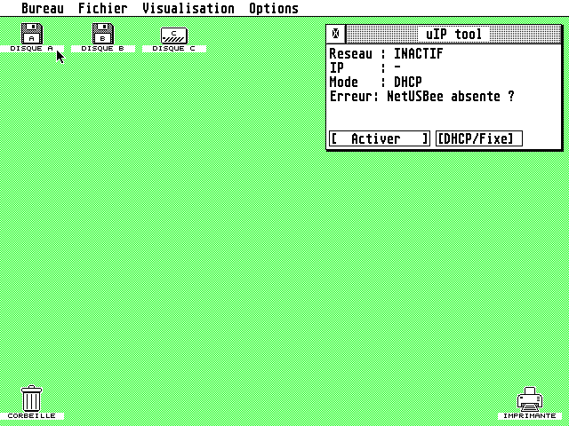

# uIP tool ACC — NetUSBee network in the background of the GEM desktop

*(Français plus bas)*

A **desk accessory** version of [uIPtool](https://bitbucket.org/sqward/uip-tools)
for Atari ST/TT/Falcon with a NetUSBee / EtherNEC cartridge.
The original `uip.tos` takes over the machine; `UIP.ACC` keeps the HTTP + FTP
server running **while the GEM desktop stays usable** (browse folders, copy
files, start GEM programs).



## Install
1. Copy `bin/UIP.ACC` to the root of your boot drive (`C:\UIP.ACC`) and reboot.
2. *Desk* menu → **uIP tool (reseau)**.
3. **[ Activer ]** starts the network, **[DHCP/Fixe]** toggles DHCP / static IP
   (static settings in `C:\UIP.CFG`, same format as `uip.tos`).
4. Browse `http://<IP>` from your PC, or FTP to port 21 (passive mode, any login).

The ON/OFF state is saved in `C:\UIPACC.INF` and restored at boot.

## Notes
- The network is serviced on GEM timer events (every 20 ms). When a
  program takes over the machine (games, TOS programs) it simply pauses and
  resumes back on the desktop. Throughput is lower than full-screen `uip.tos`.
- Remote execution ("run" / `uip-run.py`) is disabled in the accessory —
  use `bin/UIP.TOS` for that.
- While TOS shows a critical disk-error alert, the accessory pauses
  (GEMDOS is not re-entrant) — hooked through `etv_critic` (XBRA `uIPA`).
- Not compatible with STiK/STinG or MiNT (same as `uip.tos`).
- `bin/test/UIP_TEST.ACC` uses a **simulated** NIC for emulator testing only
  (Hatari has no NetUSBee). Do not install it on real hardware.

## Build
Toolchain: `m68k-atari-mintelf-gcc` 13 + [libcmini](https://github.com/freemint/libcmini) 0.54
built with `-fleading-underscore`, and a libgcc copy with prefixed symbols:

```sh
# libcmini
make CROSSPREFIX=m68k-atari-mintelf- ONLY_68K=Y BUILD_CF=N BUILD_SHORT=N \
     BUILD_FAST=N BUILD_SOFT_FLOAT=N \
     'CFLAGS=-Wall -Os -fomit-frame-pointer -fno-builtin -DSTDIO_MAP_NEWLINE \
       -Wa,--register-prefix-optional -fleading-underscore'
# libgcc with leading underscores
mkdir -p /opt/cross/ulib
m68k-atari-mintelf-objcopy --prefix-symbols=_ \
  $(m68k-atari-mintelf-gcc -m68000 -print-libgcc-file-name) /opt/cross/ulib/libgcc.a
# uIP tool
sh gen_ui.sh
make -f Makefile.acc LIBCMINI=/path/to/libcmini        # bin: build/uip.acc, build/uip.tos
make -f Makefile.acc build/uip_test.acc                  # simulated-NIC test build
```

### Files added / changed vs. upstream
| File | |
|---|---|
| `src/acc.c` | GEM window, `evnt_multi` loop, ON/OFF, autostart |
| `src/accgem.c/.h` | minimal AES/VDI bindings |
| `src/acccrit.s` | `etv_critic` hook (pause during disk-error alerts) |
| `src/uipacc.h`, `src/accshim.h` | accessory ↔ stack interface, `printf` capture |
| `src/main.c` | `uipacc_start/step/stop` (`#ifdef UIP_ACC`) |
| `src/atari_http_server/httpd.c` | remote "run" disabled in the accessory |
| `src/compat/inttypes.h`, `Makefile.acc`, `gen_ui.sh` | build without SCons |

## Tested
Hatari 2.6.1, Falcon, EmuTOS 512k (FR), VGA: loading, window, desktop usable
while active, buttons, launching a program and returning, disk-error alert.
The real network path must be validated on hardware (Hatari does not emulate
the NetUSBee).

## Credits & licences
- **uIPtool** — Mariusz Buras (Sqward) & Nokturnal (Saulot), Christian Zietz
  (USB/PicoWifi), upstream: <https://bitbucket.org/sqward/uip-tools>,
  <https://codeberg.org/nokturnal/uiptool>. See `UPSTREAM_README.md`.
- **uIP TCP/IP stack** — Adam Dunkels / SICS, BSD licence.
  *This product includes software developed by Adam Dunkels.*
- **RTL8019 driver** — based on the uIP-AVR port by Louis Beaudoin.
- **USB drivers** (`src/uip/drivers/usb/`, not used by the NetUSBee build) — GPL v2.
- **libcmini** (linked in the binaries) — FreeMiNT project, LGPL.
- Accessory front end — Haltero / Abstract, 2026.

Every source file keeps its original copyright header. Upstream has no global
licence file; this repository is published as a fork in good faith — if you
are one of the authors and want something changed, please open an issue.

---

## Français

Version **accessoire** d'uIPtool : le serveur web + FTP NetUSBee tourne
pendant que le bureau GEM reste utilisable. Copier `bin/UIP.ACC` en `C:\`,
redémarrer, puis menu *Bureau* → **uIP tool (reseau)** → **Activer**.
Notice complète : [`LISEZMOI.TXT`](LISEZMOI.TXT).
